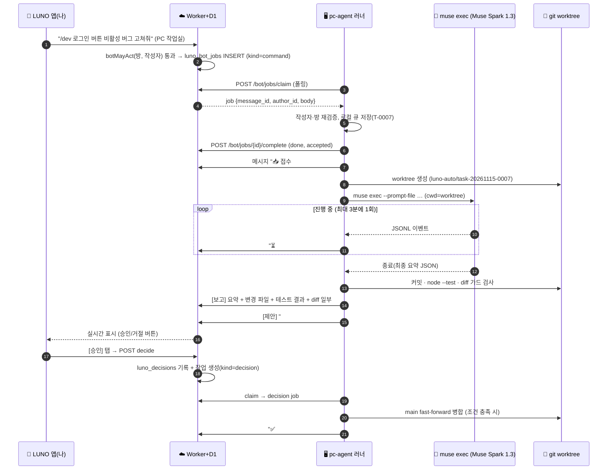

# LUNO 원격 작업 지시 시스템 — 0원 무인 아키텍처 & 즉시 구현 설계서

- 작성일: 2026-11-15 · 기준 커밋: `27dae86` (main)
- 목적: 밖에서 스마트폰 LUNO 앱으로 채팅하듯 지시 → 집 PC의 Muse(Muse Spark 1.3)가 개발·마케팅 작업 수행 → 결과를 LUNO로 보고
- 실행 트리거: 사용자가 **"보고서대로 구현 시작해"** 라고 하면 [섹션 7](#섹션-7-단계별-즉시-구현-실행-계획)의 Phase 1부터 순서대로 진행한다.
- 표기: ✅ = 이번 조사에서 직접 확인한 사실 · 🔎 = Phase 1에서 실측으로 확정할 항목(설계는 두 경우 모두 대응하도록 짜여 있음)

---

## 0. 조사 결과 요약 (결론부터)

| 질문 | 결론 |
|---|---|
| Muse를 API 키 없이 무인으로 돌릴 수 있나? | ✅ **가능.** VS Code의 Muse 확장 3종(Muse Studio, Muse Spark Code, Muse Code Unofficial)은 모두 로컬 **`muse` CLI(Muse Code 1.4.20)** 를 감싼 UI다. CLI에 공식 헤드리스 명령 `muse exec`가 있고, 구독 로그인 상태(`muse usage` → "Tier: Muse Code Power Usage", 주간 45% 사용)로 동작한다. API 키 불필요. |
| VS Code 창을 조작해야 하나? (방식 B) | ❌ 불필요하고 불안정. Muse Studio의 명령(`muse.newChat`, `muse.focus` 등)은 프롬프트 인자를 받지 않고 webview 안에서만 입력된다. 확장 UI를 원격 조작하면 창 포커스·업데이트·재시작에 취약하다. **VS Code는 꺼져 있어도 된다.** |
| Cloudflare Tunnel이 필요한가? | ❌ **기본 경로에는 불필요.** LUNO 서버에 이미 **봇 작업 큐(L-07)** 가 있어서, 집 PC가 서버로 **바깥 방향 HTTPS 요청만** 보내 작업을 가져오면(pull) 된다. 집 PC에 열린 포트 0개. 고정 주소 Tunnel은 Cloudflare에 등록된 **유료 도메인**이 필요하고, 무료 Quick Tunnel은 재시작마다 주소가 바뀐다. → Tunnel은 도메인 구매 후 선택 사항. |
| LUNO 쪽에 새로 만들 게 많나? | ✅ **거의 없음.** 봇 계정(L-01), 방·권한 범위 토큰(L-06), 작업 큐 claim/complete(L-07), 멘션→작업 라우팅(L-02), 허용목록·마스터 스위치(L-17), 킬스위치·일일 쿼터(L-09), 감사 로그, **제안(proposal)·승인/거절 버튼(L-05, 웹·Flutter 모두 구현됨)**, 보고(report) 메시지 종류(L-03)가 전부 있다. 서버는 **약 40줄 추가**(슬래시 명령 라우팅 + 승인 결과 작업 생성)면 된다. |
| 최종 선정 아키텍처 | **A + C 결합**: LUNO 봇 큐(pull) → 집 PC 러너(Node.js, 무의존성) → 로컬 파일 작업 큐(C) → `muse exec` 서브프로세스(A)를 git worktree 안에서 샌드박스 켠 채 실행 → 결과를 `report`/`proposal` 메시지로 보고 → 폰에서 [승인] 버튼 → 병합. |

### 비용 0원 검증

| 항목 | 사용 수단 | 비용 |
|---|---|---|
| AI 작업 | 기존 Muse 구독(`muse exec`, 구독 한도 내) | 0원 추가 (단, 주간 한도 소모 — 러너가 90% 넘으면 대기) |
| 서버 | 기존 Cloudflare Worker + D1 (무료 플랜) | 0원. 폴링 10~30초 적응형 → 하루 약 3천~8천 요청 (무료 한도 10만/일) |
| 네트워크 | 집 PC → Worker 바깥 방향 HTTPS | 0원, 포트포워딩·고정 IP 불필요 |
| 상주 프로세스 | Windows 작업 스케줄러 (PM2 불필요) | 0원 |
| 비상 원격 제어 | Chrome 원격 데스크톱 | 0원 |

> 참고: 구독형 도구를 자동 실행에 쓰는 것이 Muse 이용약관상 허용되는지는 사용자가 한 번 확인해 둘 것. `muse exec`는 CLI가 공식 제공하는 헤드리스 명령이라 일반적인 용도로 보이지만, 약관 판단은 사용자 몫이다.

---

## 섹션 1. 전체 시스템 아키텍처 및 데이터 흐름도

### 1-1. 구성도 (ASCII)

```
 [밖] 스마트폰 LUNO 앱 (Flutter)                       [Cloudflare 무료]
 ┌──────────────────────────┐   HTTPS/WS    ┌──────────────────────────────────────┐
 │ 🖥 PC 작업실 (그룹방)      │ ───────────▶ │ luno-messenger Worker + D1           │
 │  나: /dev 로그인 버그 고쳐  │               │  POST messages                        │
 │  봇: 📥 접수 #T-0007       │ ◀─────────── │   └ routeBotCommands() ── 신규        │
 │  봇: [보고] 결과+diff      │   실시간 푸시  │        └ enqueueBotJob(kind=command)  │
 │  봇: [제안] main 병합?     │               │  luno_bot_jobs (L-07 큐)              │
 │      [승인] [거절]  ◀─탭    │               │  POST decide → enqueue(kind=decision) │
 └──────────────────────────┘               └───────────────▲──────────────────────┘
                                                            │ ① claim (10~30초 폴링, 바깥 방향만)
                                                            │ ② complete / ③ 메시지 게시
 [집] Windows 데스크탑 (24시간)                              │   (봇 범위 토큰 cf-bot-…)
 ┌──────────────────────────────────────────────────────────┴───────────────┐
 │ pc-agent 러너 (Node.js, tools/pc-agent, 작업 스케줄러로 상주)              │
 │  ├ 인증 재검증: 작성자==나, 방==PC 작업실                                  │
 │  ├ 로컬 작업 큐 %USERPROFILE%\.luno-agent\tasks\*.json  (방식 C)          │
 │  ├ 순차 실행기 (동시 1개)                                                  │
 │  │   ├ git worktree add C:\luno-wt\T-0007  -b luno-auto/task-…            │
 │  │   ├ muse exec --json --prompt-file …  (방식 A, 샌드박스 ON, 승인 never)│
 │  │   ├ 타임아웃·단계 상한·프로세스 트리 강제 종료                          │
 │  │   ├ 러너가 직접: 커밋 · 테스트 · diff 가드 검사 · 비밀값 마스킹          │
 │  │   └ 보고(report) + 제안(proposal) 게시                                  │
 │  └ 승인 시: main fast-forward 병합 (main 작업폴더가 깨끗할 때만)           │
 │ 하트비트 파일 → 감시 작업(5분마다)이 죽은 러너 재시작                       │
 └───────────────────────────────────────────────────────────────────────────┘
   VS Code(Muse Studio)는 선택: 귀가 후 `muse resume <세션ID>`로 같은 세션 열람
```

### 1-2. 시퀀스 (Mermaid)



### 1-3. 왜 이 구조인가 (방식 비교)

| 기준 | A. CLI 직결 | B. VS Code 확장 브릿지 | C. 파일 큐 | **선정: A+C** |
|---|---|---|---|---|
| VS Code 창 상태 의존 | 없음 | 높음(포커스·webview·업데이트) | 없음 | 없음 |
| 무인 승인 제어 | `--approval-mode never` + OS 샌드박스 공식 플래그 | 확장 내부 설정·자동클릭 필요(비공식) | 실행 주체 별도 필요 | 공식 플래그 |
| 진행 상황 수집 | `--json` JSONL 이벤트 | webview 스크래핑 불가 | 파일 폴링 | JSONL |
| 재부팅·충돌 후 복구 | 프로세스만 다시 띄우면 됨 | 창 복원 필요 | 큐 파일로 재개 | 큐 파일로 재개 |
| 결론 | 실행 엔진으로 채택 | **기각** | 영속 큐로 채택 | ✅ |

---

## 섹션 2. 현재 LUNO 코드베이스 연동 지점 (Pinpoint Analysis)

### 2-1. 기술 스택 (✅ 확인)

| 계층 | 위치 | 비고 |
|---|---|---|
| 백엔드(운영) | [scripts/cf_worker.js](scripts/cf_worker.js) (7,585줄) → `node scripts/build_cf.js` → `dist_worker/` | Cloudflare Worker, D1(`luno-messenger-db`), R2(`luno-media`), Durable Object `UserSocketHub`(실시간 WS) |
| 설정 | [wrangler.jsonc](wrangler.jsonc) | `vars`에 `LLM_ENABLED` **없음 → 현재 봇 라우팅 꺼짐** |
| 웹 클라이언트 | [apps/user-web/](apps/user-web/) (Vue 3 + TS) | 메시지 렌더 [MessagePane.vue](apps/user-web/src/components/MessagePane.vue), 화면 [MessengerView.vue](apps/user-web/src/views/MessengerView.vue) |
| 모바일 | [mobile/flutter_app/](mobile/flutter_app/) | 대화방 [chat_room.dart](mobile/flutter_app/lib/pages/chat_room.dart), 상태 [session.dart](mobile/flutter_app/lib/state/session.dart) |
| 기존 봇 러너 | [agent/main.go](agent/main.go) (Go 표준 라이브러리) | 멘션 작업 처리 + 비밀값 마스킹(L-10). 이번 러너의 참고 구현 |
| Go 백엔드 | [backend/](backend/) | 운영 경로 아님(메모리: Worker+D1 유지 결정) |
| 테스트 | `scripts/*.test.mjs` (`node --test`) | 봇 관련: [scripts/llm_bots.test.mjs](scripts/llm_bots.test.mjs) |

### 2-2. 메시지 송수신 파이프라인과 기존 봇 기능 (✅ 확인)

| 기능 | 코드 위치 | 이번 설계에서의 쓰임 |
|---|---|---|
| 메시지 전송 핸들러 | `cf_worker.js:4237` `POST conversations/:id/messages` | 슬래시 명령 감지 지점 (`routeBotMentions` 호출 직후 `:4345`) |
| 멘션→작업 라우팅 | `routeBotMentions()` `:2716` | 같은 패턴으로 `routeBotCommands()` 추가 |
| 봇 작업 큐 등록 | `enqueueBotJob()` `:2748` | 그대로 사용 |
| 큐 claim / complete | `:5423` / `:5455` (잠금 120초, 최대 5회 재시도) | 러너가 사용. **120초 잠금 → 러너는 claim 즉시 로컬 큐에 옮기고 complete** (긴 작업이 중복 실행되지 않도록) |
| 봇 허용 경로 | `isBotApiRoute()` `:2704` | messages GET/POST, conversation GET, sync GET, claim/complete만 허용 → 변경 불필요 |
| 허용 판단 | `botMayAct()` `:2562` = `LLM_ENABLED` && !kill && 방 허용 && 작성자 허용 | 4중 잠금 그대로 사용 |
| 일일 쿼터 | `BOT_DAILY_REQUESTS=1000` `:2571` | 충분 |
| 봇 전용 메시지 종류 | `BOT_ONLY_KINDS = proposal/decision/report` `:3034` | 보고·제안 표시 |
| 승인/거절 | `POST conversations/:id/messages/:mid/decide` `:4453` | 승인 후 러너에게 알리는 **작업 생성 추가 필요** |
| 봇 발급·토큰 | `POST admin/bots` `:5568`, `POST admin/bots/:id/tokens` (방·ops 범위, TTL 60초~30일) | Phase 0 준비 |
| 허용목록·킬스위치 | `admin/llm/allowlist` `:5636`, `PUT admin/llm/kill` `:5666` | Phase 0 준비 / 비상 정지 |
| 웹 렌더 | `MessagePane.vue:508-517` 보고/제안 태그 + 승인/거절 버튼 | 그대로 동작 |
| Flutter 렌더 | `chat_room.dart:692-728` 보고/제안 태그 + 승인/거절 버튼, `:1392` 승인함 | 그대로 동작 |

### 2-3. 수정할 기존 파일 (최소 변경)

| 파일 | 변경 | 규모 |
|---|---|---|
| [scripts/cf_worker.js](scripts/cf_worker.js) | ① `routeBotCommands(conv, authorId, msg)` 신규: `kind==='text'` 이고 본문이 `/` 로 시작하며 `botMayAct()` 통과 시, 메시지에 **봇 멘션이 있으면 멘션된 봇에게만**, 없으면 방의 **봇 멤버마다**(섹션 8-2 그룹방 대응) `enqueueBotJob({kind:'command', payload:{message_id, author_id, body(≤4000), created_at}})`. 전송 핸들러 `:4345` 옆에서 try/catch로 호출(메시징을 절대 깨지 않게). ② decide 라우트 `:4472` 뒤: 제안 작성자가 봇이고 `botMayAct(cid, myId)` 통과 시 `enqueueBotJob({botId: target.sender_id, kind:'decision', payload:{proposal_message_id, decision, decided_by}})`. ③ decision 메시지 metadata에 `proposal_message_id` 추가(러너가 본문 문자열 대신 ID로 매칭). | ~40줄 |
| [wrangler.jsonc](wrangler.jsonc) | `vars.LLM_ENABLED: "true"` 추가. 허용목록이 PC 작업실 1개뿐이라 다른 방에는 영향 없음 | 1줄 |
| [scripts/llm_bots.test.mjs](scripts/llm_bots.test.mjs) 또는 신규 `scripts/pc_agent_routing.test.mjs` | 명령 라우팅·결정 작업 테스트(아래 Phase 1) | 신규 |
| (선택, Phase 4) [MessagePane.vue](apps/user-web/src/components/MessagePane.vue), [chat_room.dart](mobile/flutter_app/lib/pages/chat_room.dart) | 봇이 있는 방에서 빠른 명령 칩(`/status` `/stop` `/dev`), report 본문 고정폭 글꼴 | 선택 |

> 주의: 현재 작업 트리에 다른 세션의 미커밋 변경(`cf_worker.js`, 그룹통화 관련)이 있다. Phase 1 착수 시 그 변경이 커밋됐는지 먼저 확인하고, 섞이지 않게 별도 커밋으로 진행한다.

### 2-4. 새로 추가할 파일

```
tools/pc-agent/                       ← 러너 (Node 24, 외부 의존성 0개, npm install 불필요)
├─ README.md                          설치·운영·비상정지 안내
├─ package.json                       { "type":"module", "private":true, "scripts":{"test":"node --test test/"} }
├─ config.example.json                설정 예시 (비밀값 없음)
├─ src/
│  ├─ index.mjs                       진입점: 폴링 루프 + 실행기 + 종료 처리
│  ├─ config.mjs                      설정 로드·검증 (fail-closed)
│  ├─ luno.mjs                        claim / complete / postMessage / sync 클라이언트
│  ├─ commands.mjs                    /dev /mkt /ask /status /stop /cancel /log /usage /help 파서
│  ├─ queue.mjs                       로컬 파일 큐 (원자적 쓰기, 재부팅 후 재개)
│  ├─ muse.mjs                        muse exec 실행·JSONL 파싱·타임아웃·트리 종료·사용량 조회
│  ├─ git.mjs                         worktree·커밋·diff·ff 병합·정리
│  ├─ guards.mjs                      경로 규칙, 금지 플래그, diff 크기, 비밀값 마스킹
│  ├─ report.mjs                      LUNO 메시지 서식 (20,000자 제한 분할)
│  └─ prompts/{dev,mkt,ask}.md        Muse에 넘기는 작업 지침 템플릿
├─ test/                              node --test (muse는 --provider echo 또는 가짜 바이너리로)
│  ├─ commands.test.mjs  queue.test.mjs  guards.test.mjs  report.test.mjs
│  ├─ muse.test.mjs (가짜 muse 스크립트로 JSONL·타임아웃·종료 검증)
│  └─ flow.test.mjs (가짜 LUNO 서버 + 가짜 muse로 접수→보고→승인→병합 전체 흐름)
├─ setup/provision.mjs                사용자가 관리자 토큰으로 1회 실행: 봇·방·허용목록·토큰 발급
└─ windows/
   ├─ power-setup.ps1                 절전 해제 등 (섹션 6)
   ├─ pc-agent-task.xml               작업 스케줄러 정의 (부팅 시 시작, 실패 시 1분 후 재시작)
   ├─ watchdog.ps1 / watchdog-task.xml 하트비트 감시 (5분마다)
   ├─ install.ps1 / uninstall.ps1
   └─ git-hooks/pre-push              main 강제 푸시·무단 푸시 차단
```

러너 상태 폴더(저장소 **밖**, Muse가 접근 못 하게):

```
%USERPROFILE%\.luno-agent\
├─ secrets.json         봇 토큰 (icacls로 본인 계정만 읽기)
├─ config.json          방 ID, 내 user_id, 경로, 한도
├─ tasks\T-0007.json    작업 상태 (queued → running → reported → merged/rejected/failed/cancelled)
├─ logs\T-0007.jsonl    muse 이벤트 원본, logs\agent.log 러너 로그 (7일 순환)
├─ prompts\T-0007.md    실제로 Muse에 넘긴 프롬프트
├─ TASK_QUEUE.md        사람이 읽는 큐 현황 (러너가 매번 재생성, 방식 C의 가시화)
├─ heartbeat            30초마다 갱신되는 타임스탬프
└─ STOP                 이 파일이 있으면 새 작업을 시작하지 않음 (물리적 비상정지)
```

### 2-5. 라우팅 설계: 일반 채팅 vs PC 작업 지시

1. **전용 방 분리**: 그룹방 "🖥 PC 작업실"(멤버: 나 + 봇 `luno_pc`). 그룹방이라 내가 방장 → 제안 승인 권한이 나에게만 있다(`convPrivileged`). 다른 방의 대화는 허용목록에 없으므로 서버에서 아예 작업이 안 생긴다.
2. **슬래시 접두어**: 그 방에서도 `/`로 시작하는 텍스트만 작업이 된다. 평소 메모·잡담은 무시.
3. **멘션 호환**: 기존 `@봇` 멘션(L-02)도 그대로 작업이 되며, 러너는 멘션 작업 본문을 `/ask`로 취급한다.

| 명령 | 동작 | 코드 수정 |
|---|---|---|
| `/dev <지시>` | 개발 작업 (섹션 4-1) | worktree에서만 |
| `/mkt <지시>` | 마케팅 작업 (섹션 4-2) | `marketing/` 등 허용 경로만 |
| `/ask <질문>` | 코드 읽고 답만 (쓰기·셸 비활성) | 없음 |
| `/status` | 실행 중 작업·대기열·경과시간·Muse 사용량·PC 가동시간 | 없음 |
| `/stop` | 실행 중 작업 즉시 중단(프로세스 트리 종료), 브랜치 보존 | 없음 |
| `/cancel T-0008` | 대기 작업 취소 | 없음 |
| `/log T-0007` | 마지막 진행 로그 40줄(마스킹) | 없음 |
| `/diff T-0007` | diff 요약 다시 보기 | 없음 |
| `/retry T-0007 <추가 지시>` | 같은 브랜치에서 이어서 작업 (`muse exec`에 이전 요약 첨부) | worktree에서만 |
| `/usage` | `muse usage` 결과 | 없음 |
| `/help` | 명령 목록 | 없음 |
| `/deploy` | 운영 배포 **제안**만 게시 → 승인 시 실행. 기본 비활성(`allowDeploy:false`) | 없음 |

### 2-6. 결과 메시지 UI/UX (기존 렌더링 재사용)

| 단계 | 메시지 종류 | 예시 |
|---|---|---|
| 접수 | `text` (답장 연결) | `📥 #T-0007 접수 · /dev · 대기 0건 · 예상 시작 즉시` |
| 시작 | `text` | `▶️ #T-0007 시작 · 브랜치 luno-auto/task-20261115-0007` |
| 진행 | `text` (3분에 최대 1회) | `⏳ #T-0007 12분 · 도구 34회 · 수정 파일 4개` |
| 완료 보고 | `report` (보고 태그) | 아래 형식 |
| 병합 제안 | `proposal` (승인/거절 버튼) | `#T-0007 결과를 main에 병합할까요? (커밋 3개, +42/−7)` |
| 결정 반영 | `text` | `✅ main 병합 완료 abc1234` / `🗑 브랜치 보관, 병합 안 함` |
| 실패 | `report` | `❌ #T-0007 실패 · 사유: 타임아웃 40분 · 로그: /log T-0007` |

`report` 본문 형식 (폰 화면 폭 고려, 20,000자 이내, 넘으면 분할):

```
#T-0007 /dev 로그인 버튼 비활성 버그 ✅ 성공 (18분)
━━━━━━━━━━
요약
- 원인: AuthView.vue에서 email 검증 정규식이 + 기호를 거부
- 수정: 정규식 교체, 테스트 1개 추가
테스트: node --test 214 통과 / 0 실패
변경 파일 (3)
 M apps/user-web/src/views/AuthView.vue  +6 −2
 A scripts/auth_email_plus.test.mjs       +31
위험/확인 필요: 없음
브랜치: luno-auto/task-20261115-0007 (커밋 2)
━━━━━━━━━━
diff 일부 (최대 120줄, 비밀값 마스킹)
...
Muse 사용량: 주간 47%
```

---

## 섹션 3. API Key 0원! Muse 무인 자동화 브릿지 상세 설계

### 3-1. 러너의 역할

| 책임 | 내용 |
|---|---|
| 수신 | LUNO 봇 큐 폴링(적응형: 작업 직후 2분간 5초, 평시 15초, 01~07시 30초). 네트워크 오류 시 지수 백오프(최대 5분) |
| 인증 재검증 | `job.room_id === config.roomId` && `payload.author_id === config.ownerUserId` 아니면 **조용히 거절**(complete failed, 응답 메시지 없음) |
| 중복 방지 | `message_id` 기준 처리 기록, 10분 넘게 지난 명령은 "오래된 명령이라 무시" 응답 |
| 큐 관리 | 로컬 파일 큐, 동시 실행 1개, 대기 최대 10개, 하루 최대 30건 |
| 실행 | worktree 준비 → `muse exec` → 커밋·테스트·가드 → 보고 |
| 승인 처리 | decision 작업 수신 → 병합/보관/배포 |
| 생존 신호 | heartbeat 파일 30초 갱신, 시작 시 `🟢 PC 작업봇 온라인 (v, 부팅 후 n분)` 게시 |

### 3-2. 러너가 사용하는 외부 API (기존 LUNO API, 변경 없음)

모든 요청: `Authorization: Bearer cf-bot-…`, Base URL `https://luno-messenger.dnjstjqppk.workers.dev/api/v1`

| 용도 | 요청 | 응답/비고 |
|---|---|---|
| 작업 가져오기 | `POST /bot/jobs/claim` | `{job:{id,bot_id,room_id,kind,payload,status,attempts,locked_until}}` 또는 `{job:null}`; 403 `LLM_KILLED`(킬스위치) → 러너 대기, 429 `BOT_QUOTA_EXCEEDED` → 다음 날까지 대기 |
| 작업 완료 | `POST /bot/jobs/{id}/complete` `{status:'done'|'failed', result, error, usage:{requests,tokens}}` | result는 4,000자 절단 |
| 메시지 게시 | `POST /conversations/{roomId}/messages` `{kind:'text'|'report'|'proposal', body, reply_to, client_id}` | `client_id = "pca-<taskId>-<step>"` → 재시도해도 중복 게시 안 됨(서버 dedup) |
| 문맥 재확인 | `GET /conversations/{roomId}/sync?since_sequence=n` | 명령 원문 재확인(선택) |

로컬 인터페이스: **열린 포트 없음.** 명령 경로는 LUNO 채팅 하나뿐이다(공격 면 최소화). 상태 확인은 `/status` 또는 `%USERPROFILE%\.luno-agent\TASK_QUEUE.md`.

### 3-3. Muse 무인 실행 메커니즘 (마우스 클릭 0회)

✅ 확인된 CLI: `C:\Users\dnjst\AppData\Local\Programs\muse\muse.cmd` → PowerShell 런처 → `muse-bin-1.4.20-R8619.1.exe`

러너가 실행하는 명령 (작업 1건):

```
muse exec
  --json                                  # JSONL 이벤트를 stdout으로
  --prompt-file %USERPROFILE%\.luno-agent\prompts\T-0007.md   # ★ 지시문은 절대 명령줄 인자로 넣지 않음
  --model muse-spark-1.3
  --reasoning-effort high                 # /dev 기본, /ask는 medium
  --workspace C:\luno-wt\T-0007           # cwd도 동일
  --approval-mode never                   # 승인 창 없이 진행 (= 자동 승인)
  --approval-judge on                     # LLM 판정기는 유지
  --sandbox-network proxy-only            # 기본값 명시
  --disable-request-user-input            # 사람에게 되묻지 않음
  --max-model-steps 150                   # 무한 루프 상한
  --session-id <uuid>                     # 귀가 후 `muse resume`로 VS Code/터미널에서 열람
  --output-schema tools\pc-agent\src\prompts\result.schema.json   # 최종 답을 JSON으로
```

핵심 원칙:

1. **"자동 승인" = `--approval-mode never` + OS 샌드박스 유지.** `--yolo`, `--disable-sandbox`, `--disable-approval`은 러너가 인자 목록을 만들 때 금지 목록으로 검사해 **실행 자체를 거부**한다(`guards.assertMuseArgs`).
2. **프롬프트 주입 방지**: 폰에서 온 문장은 파일로만 전달(`--prompt-file`). `muse.cmd` → PowerShell 경유라 명령줄 인자에 사용자 문장이 들어가면 인용 처리 사고가 날 수 있다.
3. **VS Code 불필요**: CLI가 직접 구독 계정으로 동작. VS Code를 켜 둘 필요가 없어 창 상태와 무관하게 돈다.
4. **세션 열람**: `--session-id`로 만든 세션은 귀가 후 `muse resume <id>`로 전체 대화를 볼 수 있다.
5. **사용량 가드**: 작업 시작 전 `muse usage`를 파싱(`Weekly: (\d+)% used`). 90% 이상이면 `/dev`·`/mkt`를 보류하고 알림, `/ask`·`/status`만 처리.
6. **시간 상한**: `/dev` 40분, `/mkt` 20분, `/ask` 8분. 초과 시 `taskkill /PID <pid> /T /F`로 PowerShell 런처까지 트리 전체 종료.
7. **JSONL 파싱은 관대하게**: 알려진 이벤트(도구 호출, 파일 변경, 최종 메시지)만 집계하고 모르는 이벤트는 무시. 🔎 Phase 1에서 `muse exec --provider echo --json`과 `muse schema`로 실제 이벤트 형식을 확정해 `muse.mjs`의 파서를 맞춘다.

Muse에 넘기는 지침 템플릿(요지, `prompts/dev.md`):

```
너는 LUNO 저장소의 격리된 작업 폴더(git worktree)에서 일한다. 사람은 자리에 없다.
[작업] {{사용자 지시 원문}}
[규칙]
- 이 폴더 밖의 파일을 읽거나 쓰지 마라. git push, 배포, 원격 DB 명령, 패키지 전역 설치 금지.
- wrangler.jsonc, .github/, *.jks, key.properties, .env*, scripts/migrations/ 는 수정 금지.
- 지시가 모호하면 가장 보수적인 해석으로 최소 변경만 하고, 그 판단을 요약에 적어라.
- 수정 후 관련 테스트를 실행하고 결과를 요약에 적어라. 커밋은 하지 마라(러너가 한다).
[최종 답] result.schema.json 형식: {title, summary[], tests:{command, passed, failed}, risks[], followups[]}
```

### 3-4. 로컬 작업 큐 (충돌 없는 연속 지시 처리)

상태 머신:

```
queued ──▶ running ──▶ reported ──▶ merged
   │          │           ├──────▶ rejected (브랜치 보관 7일)
   │          │           └──────▶ deploy_proposed ──▶ deployed
   │          ├──▶ failed (타임아웃/오류/가드 위반)
   │          └──▶ stopped (/stop)
   └──▶ cancelled (/cancel)
```

| 규칙 | 내용 |
|---|---|
| 순서 | 접수 순 FIFO. `/ask`·`/status`·`/stop`·`/cancel`·`/log`·`/usage`는 큐를 거치지 않고 즉시 처리 |
| 동시성 | 실행 슬롯 1개. 각 작업은 **자기 worktree**를 쓰므로 서로 파일 충돌 없음 |
| 원자성 | `tasks/T-xxxx.json`은 임시 파일에 쓴 뒤 `rename` (전원 차단에도 파일 깨짐 방지) |
| 재부팅 복구 | 시작 시 `running` 상태 작업 → `failed(재부팅으로 중단)` 처리 후 알림. 브랜치·worktree는 보존해 `/retry` 가능 |
| 서버 큐와의 관계 | 서버 잠금이 120초라 긴 작업을 서버 큐에 잡아두면 재claim·중복 실행 위험 → **claim 직후 로컬 큐에 옮기고 즉시 complete(done, {accepted:"T-0007"})** |
| 같은 파일을 건드리는 연속 지시 | 각 작업은 그 시점 main에서 분기. 먼저 병합된 작업 때문에 나중 작업이 ff 병합 불가하면 러너가 worktree에서 `git rebase main` 시도 → 충돌 시 "충돌로 자동 병합 불가, `/retry T-0008 main 기준으로 다시`" 안내 |
| 번호 | `T-` + 4자리 일련번호(상태 폴더의 카운터 파일) |

---

## 섹션 4. 개발 & 마케팅 업무별 실행 워크플로우

### 4-1. 개발: `/dev <지시>`

```
1. 접수      로컬 큐 등록, 📥 메시지
2. 사전점검  STOP 파일 없음 · muse 주간 사용량 < 90% · 디스크 여유 ≥ 10GB · 하루 30건 이하
3. 작업공간  git -C <repo> worktree add -b luno-auto/task-20261115-0007 C:\luno-wt\T-0007 main
             node_modules는 루트 것을 디렉터리 정션으로 연결(mklink /J) — 재설치 없이 테스트 가능
             🔎 package-lock.json이 바뀐 작업이면 해당 worktree에서만 npm ci --prefer-offline
4. 실행      muse exec … (섹션 3-3)  · 진행 메시지 3분 간격
5. 사후처리  러너가 직접 수행 (Muse가 아님):
             a. git status → 변경 없으면 "변경 없음" 보고 후 종료
             b. guards.checkDiff: 금지 경로·바이너리·대용량(+3,000줄 초과)·비밀값 패턴 검사 → 위반 시 failed
             c. git add -A && git commit -m "luno-auto(T-0007): <Muse 제목>"  (작성자: 본인 git 계정, 트레일러 Luno-Task: T-0007)
             d. 테스트: node --test "scripts/*.test.mjs" (10분 제한). 웹을 건드렸으면 npm run build -w @messenger/user-web 추가
             e. git diff --stat main...HEAD, diff 앞 120줄 → 마스킹
6. 보고      report 메시지 + proposal "main에 병합할까요?"
7. 승인 시   조건 모두 충족해야 병합:
             - 테스트 통과
             - <repo> main 작업폴더가 깨끗함 (git status --porcelain 비어 있음)
             - git merge --ff-only (필요시 worktree에서 rebase 먼저)
             하나라도 불충족 → 병합 보류 사유 보고, 브랜치 유지 (귀가 후 사람이 처리)
             병합 후 worktree 제거, 브랜치는 7일 보관 후 정리
   거절 시   worktree 제거, 브랜치 7일 보관 (/retry로 이어서 가능)
8. 푸시      기본 안 함(allowPush:false). 켜면 승인 후 `git push origin main` (강제 푸시는 hook이 차단)
9. 배포      /deploy → proposal → 승인 → allowDeploy:true일 때만 main 작업폴더에서 `npm run deploy`
             (기존 배포 게이트: 테스트 + pre_deploy_gate + post_deploy_gate가 그대로 돈다) → 결과 보고
```

> main 작업폴더가 깨끗해야 병합한다는 규칙은 의도된 것이다. 집에서 다른 세션(Claude Code·Muse)으로 하던 미커밋 작업과 섞이는 사고를 막는다.

### 4-2. 마케팅: `/mkt <지시>`

예: `/mkt 배달기사용 LUNO 소개 문구 3종, 인스타 캡션 톤으로`, `/mkt 다운로드 페이지 첫 문단을 더 짧게`

| 단계 | 내용 |
|---|---|
| 작업공간 | `luno-auto/mkt-20261115-0008` worktree |
| 쓰기 허용 경로 | `marketing/**` (신규 폴더), `apps/user-web/public/download.html`, `apps/user-web/public/legal/**` 는 **제외**, `apps/user-web/src/luno-i18n.ts`(문구 키만) |
| 실행 | `prompts/mkt.md` 템플릿 + `--reasoning-effort medium`, 20분 제한. 웹 검색은 Muse 기본 웹 도구 사용 |
| 산출물 | `marketing/drafts/2026-11-15-<slug>.md` (초안 여러 버전 + 근거), 랜딩 수정은 해당 파일 diff |
| 검증 | 허용 경로 밖 변경 → 실패 처리. 랜딩 수정 시 `node --test scripts/app_download.test.mjs` 실행 |
| 보고 | report 본문에 **초안 전문**을 넣어 폰에서 바로 복사 가능(분할 게시). 랜딩 수정은 diff 포함 |
| 승인 시 | main 병합. 운영 반영은 `/deploy` 별도 승인 |
| 외부 게시(SNS 등) | **자동 게시하지 않음.** 외부에 공개되는 행동이고 현재 SNS 연동 키도 없다. 나중에 게시 스크립트를 만들면 `/mkt publish <초안ID>` → proposal → 승인 시에만 실행하도록 같은 승인 흐름에 얹는다 |

### 4-3. 질문: `/ask <질문>`

- 예: `/ask 그룹통화 8명 제한은 어디서 걸려?`
- `muse exec --disable-write --disable-shell --reasoning-effort medium`, cwd = 저장소 루트(현재 미커밋 상태 포함해서 읽음), 8분 제한
- 답변을 text로 게시. 코드 변경 없음, 승인 흐름 없음.

---

## 섹션 5. 무인 가동 보안 및 안전장치

### 5-1. 인증: "나 말고는 아무도 명령 못 함" — 7중 잠금

| # | 계층 | 막는 것 | 위치 |
|---|---|---|---|
| 1 | LUNO 로그인 + 앱 잠금 | 폰 분실 시 타인 접근 | 사용자: 패스키·화면잠금 필수 |
| 2 | 서버 마스터 스위치 `LLM_ENABLED` + 킬스위치 | 전체 정지 | Worker vars / `PUT admin/llm/kill` |
| 3 | 서버 허용목록: 방 = PC 작업실 1개, 사용자 = 내 user_id 1개 | 다른 방·다른 사람 메시지가 작업이 되는 것 | `botMayAct()` |
| 4 | 봇 토큰 범위: 방 1개, ops `read/post/propose`, TTL 30일(최대) | 토큰 유출 시 피해 범위 | `luno_bot_tokens`(해시만 저장) |
| 5 | 러너 재검증: 방·작성자 일치, 10분 지난 명령 무시, message_id 중복 무시 | 서버 설정 실수·재전송 | `luno.mjs`/`index.mjs` |
| 6 | 위험 동작은 앱의 **[승인] 버튼**으로만: 병합·푸시·배포 | 채팅 문장만으로 운영 변경 | proposal/decide(L-05), 그룹방 방장만 승인 가능 |
| 7 | 집 PC에 열린 포트 0개 | 외부에서 PC로 직접 접속 | pull 구조 |

토큰 관리:
- `setup/provision.mjs`가 발급한 토큰을 `%USERPROFILE%\.luno-agent\secrets.json`에 저장하고 `icacls … /inheritance:r /grant:r "%USERNAME%:R"`로 본인만 읽게 한다. 저장소·로그·LUNO 메시지 어디에도 출력하지 않는다.
- TTL 최대 30일 → 만료 7일 전부터 러너가 `⚠️ 봇 토큰 만료 D-7` 알림. 갱신은 사용자가 `node tools/pc-agent/setup/provision.mjs --rotate`(관리자 토큰 필요).
- 유출 의심 시: 앱에서 `/stop` → 관리자 콘솔 킬스위치 → 토큰 폐기 후 재발급.

### 5-2. 샌드박스와 가드레일

| 위험 | 차단 장치 |
|---|---|
| 저장소 밖 파일 삭제·시스템 폴더 손상 | ① Muse OS 샌드박스 ON(기본값, 끄는 플래그는 러너가 거부) ② `--workspace`를 worktree로 한정 ③ worktree는 `C:\luno-wt\`(저장소·상태폴더와 분리) ④ 상태폴더·비밀값은 worktree 밖 |
| main 직접 수정 | Muse는 main 작업폴더에서 실행되지 않음(`/ask`는 쓰기·셸 비활성). main 반영은 러너의 ff 병합 + 사람 승인뿐 |
| 강제 푸시·무단 푸시 | ① 기본 푸시 안 함 ② `.git/hooks/pre-push`(모든 worktree 공유): 환경변수 `LUNO_AGENT_PUSH=1` 없으면 거부, `+`/강제 refspec·main 삭제 거부 ③ 샌드박스 네트워크 `proxy-only`(🔎 Phase 1에서 Muse 안에서 `git push`가 실제로 막히는지 실측) |
| 비밀값·서명키 변경/유출 | 금지 경로 목록(`wrangler.jsonc`, `.github/**`, `**/*.jks`, `**/key.properties`, `.env*`, `scripts/migrations/**`, `mobile/flutter_app/android/app/*.jks`) 변경 시 실패 처리. 보고 전 마스킹(기존 [agent/main.go](agent/main.go)의 L-10 정규식을 JS로 이식: `cf-bot-…`, `cf-token-…`, `sk-…`, `AKIA…`, `password=` 등) |
| 원격 DB·운영 배포 | 프롬프트로 금지 + `wrangler d1 execute --remote`, `wrangler deploy` 등이 diff·명령 로그에 등장하면 보고에 경고. 배포는 러너만, `/deploy` 승인 + `allowDeploy:true`일 때만 |
| 무한 루프·폭주 | `--max-model-steps 150`, 작업별 시간 상한, 프로세스 트리 강제 종료, 실행 1개, 대기 10개, 하루 30건, Muse 주간 90% 상한, 서버 일일 쿼터 1,000 |
| 디스크 고갈 | 시작 전 여유 10GB 확인, worktree는 종료 즉시 제거, 브랜치 7일, 로그 7일 순환 |
| 프롬프트 인젝션(웹·파일 내용이 Muse를 조종) | 샌드박스 네트워크 제한, 금지 경로 검사, 사람 승인 전에는 main·운영에 아무 영향 없음, 비밀값이 Muse 작업공간에 없음 |
| 지시 오해로 큰 변경 | diff +3,000줄 초과·파일 50개 초과 시 "대형 변경" 표시, 병합 제안 대신 "귀가 후 검토 권장" |

러너 자체의 금지 사항(코드로 강제):
- `muse` 인자에 `--yolo`, `--disable-sandbox`, `--disable-approval`, `--allow-workspace-switch` 금지
- `git push --force`, `git push … :main`, `git reset --hard` (worktree 밖), `git clean` (worktree 밖) 금지
- 셸 문자열 조합 금지: 모든 자식 프로세스는 `spawn(file, argsArray, {shell:false})` (단, `muse.cmd`는 `powershell.exe -NoProfile -ExecutionPolicy Bypass -File <런처.ps1> …`로 명시 호출하고 인자는 고정값만)

### 5-3. 비상 정지 4단계

1. 폰: `/stop` (실행 중 작업 종료) — 즉시
2. 폰: 관리자 콘솔 → LLM 킬스위치(`PUT admin/llm/kill {stopped:true}`) — 서버가 새 작업 생성·claim 모두 거부
3. 원격 데스크톱: `%USERPROFILE%\.luno-agent\STOP` 파일 생성 또는 `schtasks /End /TN "LUNO\pc-agent"`
4. 최후: 공유기/PC 전원(원격 전원 플러그 사용 시)

---

## 섹션 6. 집 데스크탑 24시간 무인 세팅 체크리스트 (0원)

현재 상태(✅ 확인): Node 24.19 · Go · git · gh · **cloudflared 설치됨** · muse CLI 1.4.20(구독 로그인됨) · Windows 11 Pro

### 6-1. 전원·절전 (관리자 PowerShell, `windows/power-setup.ps1`에 포함)

```powershell
powercfg /change standby-timeout-ac 0        # 절전 안 함
powercfg /change hibernate-timeout-ac 0      # 최대 절전 안 함
powercfg /change monitor-timeout-ac 10       # 모니터만 10분 후 끔 (작업엔 영향 없음)
powercfg /change disk-timeout-ac 0           # 디스크 끄지 않음
powercfg /hibernate off                      # 빠른 시작/최대절전 비활성 (재부팅 후 작업 스케줄러 안정)
powercfg /setacvalueindex SCHEME_CURRENT SUB_USB USBSELECTIVESUSPEND 0   # USB 절전 끔(유선랜 동글 등)
powercfg /setactive SCHEME_CURRENT
git config --global core.longpaths true      # worktree 긴 경로 대비
```

수동 설정(화면에서):
- [ ] 장치 관리자 → 네트워크 어댑터 → 전원 관리 → "전원을 절약하기 위해 컴퓨터가 이 장치를 끌 수 있음" 해제
- [ ] Windows 업데이트 → 고급 옵션 → 사용 시간을 작업 시간대(예: 08~24시)로, "재시작 필요 시 알림" 켬. 재부팅되어도 6-2 작업이 부팅 시 자동 시작
- [ ] BIOS/UEFI: "Restore on AC Power Loss = Power On" (정전 후 자동 켜짐)
- [ ] 가능하면 유선 LAN

### 6-2. 러너 상주: Windows 작업 스케줄러 (PM2 대신)

PM2는 Windows에서 부팅 자동시작이 불안정하고 추가 설치가 필요하다. 작업 스케줄러가 0원·내장·재시작 정책까지 지원한다.

`windows/pc-agent-task.xml` 핵심 설정:

| 항목 | 값 | 이유 |
|---|---|---|
| 트리거 | 시스템 시작 시(지연 1분) | 로그인 안 해도 시작 |
| 보안 옵션 | **사용자 로그온 여부와 관계없이 실행 + 암호 저장**, 본인 계정 | Muse 로그인 정보가 본인 사용자 프로필에 있음. "암호 저장 안 함(S4U)"은 자격 증명 접근이 제한될 수 있음 🔎 Phase 4에서 이 상태로 `muse usage` 성공 확인 |
| 동작 | `"C:\Program Files\nodejs\node.exe" C:\Users\dnjst\Desktop\project\line\tools\pc-agent\src\index.mjs` | |
| 실패 시 재시작 | 1분 간격, 999회 | 크래시 자동 복구 |
| 실행 시간 제한 | 없음(PT0S) | 상주 |
| 배터리/유휴 조건 | 모두 해제 | |
| 여러 인스턴스 | 새 인스턴스 실행 안 함 | 중복 러너 방지 |

설치(관리자 PowerShell): `windows/install.ps1`이 아래를 수행

```powershell
schtasks /Create /TN "LUNO\pc-agent"  /XML tools\pc-agent\windows\pc-agent-task.xml  /RU $env:USERNAME /RP *
schtasks /Create /TN "LUNO\pc-agent-watchdog" /XML tools\pc-agent\windows\watchdog-task.xml /RU $env:USERNAME /RP *
Copy-Item tools\pc-agent\windows\git-hooks\pre-push .git\hooks\pre-push
New-Item -ItemType Directory -Force "$env:USERPROFILE\.luno-agent","C:\luno-wt" | Out-Null
icacls "$env:USERPROFILE\.luno-agent" /inheritance:r /grant:r "${env:USERNAME}:(OI)(CI)F"
schtasks /Run /TN "LUNO\pc-agent"
```

감시(watchdog, 5분마다): `heartbeat` 파일이 3분 넘게 갱신 안 됐으면 `schtasks /End` 후 `/Run`, `logs\watchdog.log`에 기록.

러너 단일 인스턴스 보장: 시작 시 `%USERPROFILE%\.luno-agent\agent.lock`을 배타적으로 열고, 이미 열려 있으면 즉시 종료.

### 6-3. 비상용 원격 제어 (0원)

- [ ] **Chrome 원격 데스크톱** 설치·PIN 설정 → 폰 앱에서 집 PC 화면 접속 (VS Code·Muse Studio 직접 조작, 작업 스케줄러 재시작 등)
- [ ] 폰 브라우저/앱에서 관리자 콘솔 접속 가능 확인(킬스위치용)

### 6-4. cloudflared는? (선택, 지금은 불필요)

- 이 설계의 기본 경로는 **집 PC → Cloudflare Worker 바깥 방향 요청**만 쓰므로 Tunnel이 필요 없다.
- 무료 Quick Tunnel(`cloudflared tunnel --url http://localhost:PORT`)은 재시작마다 주소가 바뀌어 무인 운영에 부적합.
- 고정 주소 Named Tunnel + Cloudflare Access(무료)는 **Cloudflare에 등록된 도메인**이 필요(도메인 구매비 발생). CEO 조치 목록의 도메인 구매가 끝나면, 실시간 로그를 보는 읽기 전용 페이지를 `agent.<도메인>`에 Access(내 이메일만 허용)로 붙이는 확장을 고려할 수 있다. 그때도 명령 경로는 LUNO 채팅으로 유지한다.

---

## 섹션 7. 단계별 즉시 구현 실행 계획

진행 원칙: 각 Phase 끝에서 테스트 통과를 확인하고 커밋한다. 운영 반영(`npm run deploy`)과 관리자 권한 작업은 기존 규칙대로 **사용자 승인/실행**을 거친다(메모리: 원격 D1 쓰기·권한 자가설정은 Claude가 하지 않음).

### Phase 0 — 사용자 사전 준비 (사람이 할 일, 약 10분, Phase 1 배포 후 진행)

- [ ] 폰 LUNO에서 그룹방 "🖥 PC 작업실" 생성 (나 혼자)
- [ ] `node tools/pc-agent/setup/provision.mjs` 실행 (관리자 토큰 입력; Claude가 Phase 2에서 작성) → 순서대로:
  - [ ] `POST admin/bots {display_name:"PC 작업봇", handle:"luno_pc"}`
  - [ ] 봇을 PC 작업실에 초대
  - [ ] `POST admin/llm/allowlist` 방 = PC 작업실 ID, 사용자 = 내 user_id
  - [ ] `POST admin/bots/:id/tokens {rooms:[방ID], ops:["read","post","propose"], ttl_sec:2592000}`
  - [ ] 토큰·방ID·내 user_id를 `%USERPROFILE%\.luno-agent\secrets.json`/`config.json`에 저장(화면에 토큰 출력 안 함)
- [ ] 패스키·앱 화면잠금 켜져 있는지 확인

### Phase 1 — 서버 라우팅 + Muse 실측 (반나절)

서버:
- [ ] 현재 미커밋 변경(그룹통화 작업) 상태 확인 → 섞이지 않게 분리
- [ ] `cf_worker.js`: `routeBotCommands()` 추가, 전송 핸들러 `:4345` 옆에서 try/catch 호출
- [ ] `cf_worker.js`: decide 라우트에서 봇 제안이면 `kind:'decision'` 작업 생성 + decision 메시지 metadata `proposal_message_id`
- [ ] `wrangler.jsonc`: `LLM_ENABLED: "true"`
- [ ] 테스트 `scripts/pc_agent_routing.test.mjs`:
  - [ ] 허용 방·허용 사용자의 `/dev x` → command 작업 1건
  - [ ] `/` 없는 텍스트 → 작업 0건
  - [ ] 허용 안 된 사용자/방 → 0건, 킬스위치 ON → 0건, `LLM_ENABLED` 꺼짐 → 0건
  - [ ] 봇 자신이 쓴 `/…` → 0건
  - [ ] 봇 2개 있는 그룹방: `@PC-쇼핑몰 /dev x` → 쇼핑몰 봇만 1건, 멘션 없는 `/dev x` → 봇마다 1건(러너가 message_id로 합침)
  - [ ] `/dev x`에 들어 있는 `@all` 멘션 → 0건 (기존 규칙 유지)
  - [ ] 봇 제안 승인/거절 → decision 작업 1건(payload 정확), 사람 제안은 0건
  - [ ] 라우팅 예외가 나도 메시지 전송은 201
- [ ] `node --test "scripts/*.test.mjs"` 전체 통과
- [ ] 사용자 승인 후 `npm run deploy` (기존 게이트 그대로)

Muse 실측(🔎 항목 확정, 결과를 `tools/pc-agent/README.md`에 기록):
- [ ] `muse exec --provider echo --json "hi"` → JSONL 이벤트 샘플 저장(`test/fixtures/echo.jsonl`)
- [ ] `muse schema` 로 이벤트 스키마 확인 → 파서 필드 확정
- [ ] `muse sandbox` 상태 확인(설정 안 됐으면 `muse sandbox` 설정 절차 실행)
- [ ] 임시 worktree에서 실제 모델로 짧은 작업 1회: 파일 1개 수정 성공, **worktree 밖 쓰기 시도 차단**, **`git push` 차단** 확인
- [ ] `--output-schema` 동작 확인(안 되면 최종 메시지에서 JSON 블록 추출로 대체)
- [ ] `muse usage` 출력 파싱 정규식 확정

### Phase 2 — 러너 코어 (하루)

- [ ] `tools/pc-agent/` 골격, `package.json`(의존성 0), `config.example.json`
- [ ] `config.mjs`: 필수값(baseUrl, roomId, ownerUserId, repoPath, worktreeRoot, museLauncher) 없으면 시작 거부
- [ ] `luno.mjs`: claim/complete/post(client_id dedup)/sync, 403 `LLM_KILLED`·429 처리, 지수 백오프
- [ ] `commands.mjs`: 섹션 2-5 명령 파서 (+ 멘션 작업 → `/ask`)
- [ ] `queue.mjs`: 원자적 파일 큐, 상태 머신, 재부팅 복구, `TASK_QUEUE.md` 생성, 일련번호
- [ ] `muse.mjs`: 인자 조립 + `guards.assertMuseArgs`, `--prompt-file`, JSONL 스트림 파서, 타임아웃, `taskkill /T /F`, `usage()` 파서
- [ ] `guards.mjs`: 금지 경로, 마케팅 허용 경로, diff 크기, 마스킹(agent/main.go L-10 이식)
- [ ] `report.mjs`: 접수/시작/진행/보고/실패/제안 서식, 20,000자 분할
- [ ] `index.mjs`: 적응형 폴링 루프, 단일 인스턴스 락, heartbeat, STOP 파일, 시작 알림, 즉시 명령(`/status /stop /cancel /log /usage /help`)
- [ ] `setup/provision.mjs`: Phase 0 자동화 (`--rotate` 포함), 토큰 화면 출력 금지
- [ ] 테스트: commands / queue(전원차단 모사) / guards(금지 플래그·경로·마스킹) / report(분할) / muse(가짜 muse로 JSONL·타임아웃·트리 종료)
- [ ] `cd tools/pc-agent && node --test test/` 통과

### Phase 3 — 개발·마케팅 워크플로우 + 승인 흐름 (하루)

- [ ] `git.mjs`: worktree 생성(정션 node_modules), 커밋(트레일러 `Luno-Task`), diff stat/본문, main 깨끗함 검사, rebase, ff 병합, worktree·브랜치 정리
- [ ] `prompts/dev.md`, `prompts/mkt.md`, `prompts/ask.md`, `prompts/result.schema.json`
- [ ] `/dev` 전 과정(섹션 4-1), `/mkt`(4-2, 허용 경로 검사), `/ask`(4-3), `/retry`, `/diff`
- [ ] decision 작업 처리: 승인 → 병합 조건 검사 → 병합/보류 보고, 거절 → 보관
- [ ] `/deploy`: proposal 게시 → 승인 → `allowDeploy`일 때만 `npm run deploy` → 결과 보고 (기본 false)
- [ ] `windows/git-hooks/pre-push`
- [ ] `test/flow.test.mjs`: 가짜 LUNO 서버(로컬 http) + 가짜 muse + 임시 git 저장소로 접수→실행→보고→승인→ff 병합, 거절, main 더러움→보류, 금지 경로→실패, 타임아웃→실패, `/stop` 전체 검증
- [ ] 실제 Muse로 로컬 리허설: 임시 저장소 사본에서 `/dev README 오타 수정` 1건 종단 실행

### Phase 4 — 24시간 무인화 + 폰 종단 검증 (반나절)

- [ ] `windows/power-setup.ps1`, `pc-agent-task.xml`, `watchdog.ps1`, `watchdog-task.xml`, `install.ps1`, `uninstall.ps1` 작성
- [ ] 사용자: 관리자 PowerShell로 `install.ps1` 실행 (암호 입력은 사용자가 직접)
- [ ] 작업 스케줄러 컨텍스트에서 `muse usage` 성공 확인(실패 시 대안: 자동 로그온 + "로그온할 때" 트리거로 전환 — 보안 저하를 설명하고 사용자 선택)
- [ ] 재부팅 테스트: 재부팅 → 로그인 없이 2분 내 `🟢 온라인` 메시지 수신
- [ ] 크래시 테스트: 러너 프로세스 강제 종료 → 1분 내 재시작
- [ ] 폰 종단 테스트(밖에서 LTE로): `/status` → `/ask` → `/dev 작은 변경` → [승인] → 병합 확인 → `/stop` → 킬스위치
- [ ] Chrome 원격 데스크톱 설치·접속 확인
- [ ] (선택) 웹·Flutter: PC 작업실에서 빠른 명령 칩, report 고정폭 표시
- [ ] `tools/pc-agent/README.md`에 운영 수칙·비상정지·토큰 갱신 절차 정리, 메모리에 운영 요점 기록

### Phase 2~3에 포함: 여러 프로젝트 지원 (섹션 8)

- [ ] `config.json`을 `projects[]` 배열 구조로 (처음부터 다중 프로젝트 전제, LUNO는 첫 항목)
- [ ] 러너가 봇 토큰 여러 개를 돌아가며 claim, 작업에 `projectId` 기록, 작업 번호 `<접두어>-0001`
- [ ] 프로젝트별 금지 경로·테스트 명령·마케팅 허용 경로·시간 상한
- [ ] `provision.mjs --project <id> --repo <경로>`로 프로젝트 추가 자동화 (봇 발급 → 친구 목록 노출 → 방 생성·초대 → 허용목록 → 토큰)
- [ ] `/status`에 전체 프로젝트 대기열 표시, `test/flow.test.mjs`에 2개 프로젝트 동시 지시 케이스 추가
- [ ] 그룹방 형태(섹션 8-2): 같은 message_id로 온 여러 봇 작업 합치기, 프로젝트 결정 순서(멘션 → 명령 뒤 프로젝트 이름 → 방 기본 프로젝트 → 되묻기), 보고는 해당 프로젝트 봇 이름으로 게시
- [ ] `provision.mjs --group "PC 통합 작업실" --projects line,shop,blog`: 그룹방에 여러 봇 초대·허용목록·토큰(방 2개 범위: 전용방 + 통합방)
- [ ] 테스트: 그룹방에서 멘션 지목, `/dev shop …` 지목, 미지정 시 되묻기, 미지정 메시지가 두 번 실행되지 않음

### 완료 기준 (Definition of Done)

- 밖에서 폰으로 `/dev` 지시 → 사람 손 없이 브랜치 작업·테스트·보고까지 완료
- 승인 버튼 한 번으로 main 병합, 거절 시 main 무변경
- 허용 안 된 사용자·방·만료 토큰·킬스위치 상태에서는 어떤 작업도 실행되지 않음(테스트로 증명)
- 재부팅·크래시 후 자동 복구, 열린 인바운드 포트 0개, 추가 비용 0원

---

## 섹션 8. 여러 프로젝트로 확장 — "친구추가" 방식

LUNO 말고 다른 프로젝트(예: 쇼핑몰, 블로그)도 같은 방식으로 지시할 수 있다. **프로젝트 1개 = 봇 친구 1명 = 작업방 1개**.

```
LUNO 친구 목록                         집 PC 러너 (1개)
 🤖 PC-LUNO   [BOT] ── 방: LUNO 작업실 ──▶ projects[0] repo: C:\…\project\line
 🤖 PC-쇼핑몰  [BOT] ── 방: 쇼핑몰 작업실 ─▶ projects[1] repo: C:\…\project\shop
 🤖 PC-블로그  [BOT] ── 방: 블로그 작업실 ─▶ projects[2] repo: C:\…\project\blog
```

| 항목 | 설계 |
|---|---|
| 친구 추가 | 봇 계정은 이미 친구 목록에 `BOT` 뱃지로 표시된다(`FriendPanel.vue:177,259`). 프로젝트를 추가할 때 `provision.mjs --project shop --repo C:\…\shop --name "PC-쇼핑몰"`이 봇 발급 → 나와 친구 연결 → 작업방 생성·초대 → 허용목록 → 토큰 발급까지 한 번에 처리 |
| 서버 변경 | **없음.** 봇·방·토큰이 프로젝트마다 따로라 섹션 2-3의 라우팅 그대로 동작. 토큰이 방 1개로 제한되므로 A 프로젝트 토큰으로 B 방을 건드릴 수 없음 |
| 러너 | 1개가 모든 프로젝트 담당. `config.json`의 `projects[]`: `{id, name, botTokenRef, roomId, repoPath, mainBranch, testCommand, forbiddenPaths[], mktAllowedPaths[], timeouts}` |
| 실행 순서 | 프로젝트별 대기열 + **전체 동시 실행 1개**(Muse 구독 한도·PC 자원 공유). 프로젝트 간 번갈아 처리(한 프로젝트가 독점하지 않게) |
| 작업 번호·브랜치 | `SHOP-0003`, `luno-auto/shop-20261115-0003`, worktree `C:\luno-wt\SHOP-0003` |
| 폴링 비용 | 봇 수만큼 claim 요청 증가 → 평시 간격을 프로젝트 수에 비례해 늘려 Worker 무료 한도(10만/일) 내 유지. 3개 프로젝트 기준 하루 약 1만 요청 |
| 프로젝트 조건 | git 저장소여야 함(아니면 provision이 `git init` + 첫 커밋을 제안). 테스트 명령이 없으면 "테스트 없음"으로 보고 |
| 안전장치 | 섹션 5 그대로 프로젝트마다 적용. 프로젝트 제거: `provision.mjs --remove shop` → 토큰 폐기, 허용목록 삭제, 설정에서 제외 |
| 한도 | 봇 토큰 TTL 30일은 봇마다 따로 → 만료 알림도 해당 작업방으로 |

### 8-2. 그룹방 형태 — 봇 여러 명을 한 방에

1:1 전용방(8-1 위 표)과 **함께** 쓸 수 있다. 통합 그룹방 하나에 프로젝트 봇을 모두 초대해서, 한 방에서 모든 프로젝트를 지시하고 보고를 모아 본다.

```
🖥 PC 통합 작업실 (그룹방, 방장 = 나)
 멤버: 나, 🤖 PC-LUNO, 🤖 PC-쇼핑몰, 🤖 PC-블로그
 나:   @PC-쇼핑몰 /dev 장바구니 수량 버그 고쳐줘
 🤖PC-쇼핑몰: 📥 #SHOP-0003 접수
 나:   /mkt line 배달기사용 소개 문구 3종
 🤖PC-LUNO:  📥 #LINE-0012 접수 (대기 1건: SHOP-0003 실행 중)
 나:   /status
 🤖PC-LUNO:  실행 중 SHOP-0003(9분) · 대기 LINE-0012 · Muse 주간 52%
```

프로젝트 지목 방법 (러너가 이 순서로 결정):

| 순서 | 방법 | 예 |
|---|---|---|
| 1 | 봇 멘션 | `@PC-쇼핑몰 /dev …` |
| 2 | 명령 바로 뒤 프로젝트 이름 | `/dev shop …`, `/mkt line …` |
| 3 | 방의 기본 프로젝트 (1:1 전용방이면 그 프로젝트) | 전용방에서 `/dev …` |
| 4 | 그래도 모르면 실행하지 않고 되묻기 | `어느 프로젝트? @PC-LUNO / @PC-쇼핑몰 / @PC-블로그 또는 /dev line …` |

동작 원리:

| 항목 | 설계 |
|---|---|
| 서버 | `routeBotCommands()`: 봇 멘션이 있으면 멘션된 봇에게만 작업 생성, 없으면 방의 봇 전원에게 생성 (섹션 2-3 ①). 서버 쪽 추가 변경은 이것뿐 |
| 중복 방지 | 멘션 없는 명령은 봇 수만큼 작업이 생기지만, 러너는 하나라서 `message_id`로 합쳐 **한 번만** 처리 |
| 토큰 범위 | 각 봇 토큰의 `rooms`에 [전용방, 통합방] 두 개를 넣어 발급 |
| 보고 | 해당 프로젝트 봇 이름으로 게시 → 누가 보고했는지 보고 바로 프로젝트를 알 수 있음. `/status`·되묻기는 첫 번째 봇이 대표로 답함 |
| 승인 | 그룹방 방장(나)만 [승인] 가능 (기존 L-05 규칙). 승인 결과는 제안을 올린 봇에게만 작업으로 전달 |
| 다른 사람 초대 | 통합방에 동료를 초대하면 진행 상황·보고는 함께 볼 수 있지만, 허용목록에 내 user_id만 있으므로 **동료의 명령은 실행되지 않고**, 승인도 방장만 가능 |
| 전용방 vs 통합방 | 둘 다 써도 된다. 같은 프로젝트 대기열을 공유하므로 어느 방에서 지시해도 순서가 꼬이지 않는다. 보고는 지시가 온 방에 게시 |

---

## 섹션 9. 실사용 보강 기능 (배달 중 사용 기준)

조사로 확인한 사실(✅): LUNO 서버에 **FCM 푸시 없음**(`cf_worker.js:2765` "No FCM driver"), **정기 실행(cron) 핸들러 없음**, 봇 허용 경로에 **첨부파일 없음**(`isBotApiRoute`), GitHub 원격 저장소 있음, 집 PC에 **`muse voice transcribe`**(음성→글, 구독 포함)와 **Ollama**(로컬 AI, 무료) 설치됨.

| # | 기능 | 우선순위 | 왜 필요한가 | 서버 변경 |
|---|---|---|---|---|
| 9-1 | 보고 도착 알림 | **필수** | 앱이 꺼져 있으면 보고가 와도 모름 | 없음(임시안) / FCM(정식) |
| 9-2 | PC 꺼짐 감지 알림 | **필수** | 정전·재부팅 실패 시 지시가 허공에 쌓임 | cron 추가 |
| 9-3 | 음성으로 지시 | **필수** | 배달 중 타이핑 어려움 | 봇 첨부 읽기 + 음성 라우팅 |
| 9-4 | 보고에 답장해서 이어서 지시 | **필수** | `/retry T-0007 …` 입력이 번거로움 | 라우팅 조건 1줄 |
| 9-5 | 화면 캡처 보고 | 권장 | 화면 변경 결과를 폰으로 확인 | 봇 첨부 올리기 |
| 9-6 | GitHub 앱으로 전체 diff 보기 | 권장 | 보고에는 diff 120줄만 들어감 | 없음 |
| 9-7 | 되돌리기 `/revert` | 권장 | 병합 후 문제 발견 시 | 없음 |
| 9-8 | 긴급 지시 `/dev!` | 권장 | 대기열 맨 앞으로 | 없음 |
| 9-9 | 아침 브리핑·정기 작업·승인 대기 알림 | 권장 | 하루 시작 시 상황 파악 | 없음 |
| 9-10 | Muse 한도 초과 시 Ollama로 `/ask` | 선택 | 주간 한도 소진 대비 | 없음 |

### 9-1. 보고 도착 알림

- **정식**: CEO 조치 목록의 Firebase(FCM) 설정이 끝나면 기존 알림 경로(`notify()` → 공급자 연결 자리)로 자동 해결. 러너 쪽 추가 작업 없음.
- **그 전까지 임시안 (0원, 기본 꺼짐)**: 무료 푸시 서비스 ntfy(안드로이드 앱)에 러너가 **내용 없는 알림만** 보냄. 예: `LUNO: SHOP-0003 완료` (요약·코드·diff는 절대 보내지 않음, 주제 이름은 추측 불가능한 무작위 32자). 외부 서비스로 나가는 정보이므로 `notify.ntfyTopic`을 사용자가 직접 설정해야 켜짐.
- 알림 대상: 완료·실패·승인 대기·PC 꺼짐만. 진행 메시지는 알림 안 함.

### 9-2. PC 꺼짐 감지

- **CEO 확정(2026-11-15): cron은 2분에 1번.** 서버: `wrangler.jsonc`에 `"triggers": {"crons": ["*/2 * * * *"]}` (무료 플랜 허용, 하루 720회), Worker에 `scheduled()` 핸들러 추가. 이 cron은 PC 꺼짐 감지 전용이다(F28 데이터 정리 등 다른 작업을 얹지 않는다).
- claim 처리 시 `luno_bot_config`에 `seen:<botId>` 시각 기록(60초에 한 번만 써서 D1 쓰기 절약, 봇당 하루 약 1,440건).
- 러너는 야간에도 폴링 간격 30초 이하를 유지한다(마지막 접속 기록이 최대 90초 늦게 갱신됨).
- cron이 마지막 접속 **3분 초과**를 발견하면(실제 감지까지 약 3~5분) 해당 봇 이름으로 작업방에 1회 게시: `⚠️ 집 PC 응답 없음 (마지막 접속 14:02) — 정전·재부팅 확인 필요`. 복구 시 러너가 `🟢 복구됨, 대기 중 지시 n건 처리 시작`.
- 테스트: 마지막 접속 4분 전 → 경고 1회, 2분 전 → 경고 없음, 연속 cron에도 중복 경고 없음, 복구 후 다시 꺼지면 다시 경고.

### 9-3. 음성 지시

```
나: 🎤 (음성) "쇼핑몰 장바구니 수량 버그 고쳐줘"
🤖PC-쇼핑몰: 🎤 받아쓰기: "/dev 장바구니 수량 버그 고쳐줘"  [제안: 이대로 실행할까요?]  [승인] [거절]
나: [승인] → 일반 /dev 흐름
```

- 서버: `routeBotCommands()`가 PC 작업방의 `kind==='voice'` 메시지도 작업으로 넘김(payload에 attachment_id). `isBotApiRoute`에 `GET attachments/:id/content` 추가 — 단 **첨부가 속한 방이 토큰 범위 안**이고 `read` 권한일 때만.
- 러너: 첨부 다운로드 → `muse voice transcribe <파일>` → 문장 앞의 "개발/마케팅/질문/상태/중지"와 프로젝트 이름을 명령으로 변환 → **반드시 확인 제안을 거침**(받아쓰기 오류로 엉뚱한 작업이 실행되는 것 방지). `/status`·`/stop`처럼 코드를 바꾸지 않는 명령은 확인 없이 바로 실행.
- 🔎 Phase 5에서 확인: LUNO 앱 녹음 형식(webm/ogg/m4a)과 `muse voice`가 받는 형식(m4a, wav). 다르면 무료 ffmpeg(`winget install ffmpeg`)로 wav 변환.
- 음성 파일은 받아쓴 뒤 PC에서 즉시 삭제.

### 9-4. 보고에 답장해서 이어서 지시

- 봇의 보고·제안 메시지에 **답장**으로 보낸 글은 `/` 없이도 작업이 됨 → 그 작업의 `/retry`로 처리(같은 브랜치에서 이어서).
- 서버: 라우팅 조건에 `msg.reply_to`가 봇 메시지인 경우 추가.
- 예: 보고에 답장 "버튼 색은 파란색으로" → `/retry SHOP-0003 버튼 색은 파란색으로`.

### 9-5. 화면 캡처 보고

- 웹 화면(`apps/user-web/**`)이 바뀐 작업이면 러너가 worktree에서 개발 서버를 띄우고, 이미 설치된 Playwright로 폰 크기(390×844)와 PC 크기(1280×800)를 캡처해 보고에 이미지로 첨부.
- 캡처할 화면 목록은 프로젝트 설정 `screenshots[]`(예: `/`, `/download.html`). 로그인 필요 화면은 로컬 테스트 계정으로만.
- 서버: `isBotApiRoute`에 `POST attachments` 추가 — 토큰 범위 안의 방, `post` 권한, 이미지 형식만, 최대 5MB.

### 9-6. GitHub 앱으로 전체 diff 보기 (기본 꺼짐)

- `allowPushBranches: true`이면 승인 전에 `luno-auto/*` 브랜치만 GitHub에 올리고, 보고에 비교 링크 `https://github.com/<저장소>/compare/main...luno-auto/…`를 넣음. 폰의 GitHub 앱에서 전체 변경 확인 가능.
- `pre-push` hook: `luno-auto/*`만 허용, main·강제 푸시·삭제는 계속 차단. 병합·거절 후 원격 브랜치 7일 뒤 삭제.

### 9-7. 되돌리기 `/revert T-0007`

- 병합된 커밋을 되돌리는 커밋을 새 브랜치에 만들고 테스트 → 제안 → 승인 시 main 반영. 이미 운영 배포된 변경이면 "운영에는 아직 남아 있음, `/deploy` 필요"를 함께 안내.

### 9-8. 긴급 지시 `/dev!`, `/mkt!`

- 대기열 맨 앞에 넣음(실행 중인 작업은 끊지 않음). 하루 5회 제한.

### 9-9. 아침 브리핑·정기 작업·승인 대기 알림

- 아침 브리핑(기본 07:30, 통합방 또는 첫 작업방): 지난 24시간 완료·실패, **승인 대기 중인 제안**, 브랜치 보관 만료 예정, Muse 주간 사용량, 봇 토큰 만료일.
- 정기 작업: `/every 07:00 /ask 어제 커밋 요약`, `/every list`, `/every off <번호>` (최대 5개, 러너 상태 폴더에 저장).
- 승인 대기 알림: 제안이 6시간 넘게 대기 중이면 1회 재알림.
- 조용한 시간(기본 01:00~07:00): 진행 메시지 생략, 완료 보고만.

### 9-10. 대체 엔진 (선택)

- `muse.mjs`를 엔진 인터페이스(`engines/muse.mjs`, `engines/ollama.mjs`)로 분리.
- Muse 주간 사용량 90% 이상일 때 `/ask`만 로컬 Ollama 모델로 답함(인터넷·구독 불필요). 코드 수정(`/dev`·`/mkt`)은 품질 때문에 Muse 전용 유지, 한도가 풀릴 때까지 대기.
- 다른 구독형 CLI도 같은 인터페이스로 붙일 수 있지만 각 서비스 약관 확인이 필요해 기본 제외.

### Phase 5 — 실사용 보강 (Phase 4 완료 후, 하루)

- [ ] 서버: 음성·답장 라우팅, 봇 첨부 읽기/올리기 경로(범위 검사), `scheduled()` + cron, `seen:<botId>` 기록 + 테스트 (`scripts/pc_agent_routing.test.mjs`에 추가)
- [ ] 사용자 승인 후 `npm run deploy`
- [ ] 러너: 9-1 ntfy(기본 꺼짐), 9-3 받아쓰기·확인 제안, 9-4 답장 이어서, 9-5 캡처, 9-6 브랜치 푸시(기본 꺼짐), 9-7 `/revert`, 9-8 긴급, 9-9 브리핑·정기·리마인더·조용한 시간, 9-10 엔진 분리
- [ ] 테스트: 가짜 음성 파일 받아쓰기 → 확인 제안 → 승인 → 실행, 답장 → 같은 브랜치 이어서, revert 흐름, 정기 작업 시간 계산, 조용한 시간
- [ ] 폰 종단 테스트: 밖에서 음성 지시 1건, 답장 이어서 1건, 집 PC 전원 뽑기 → 5분 내 경고 수신
