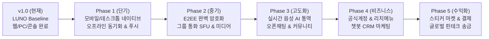
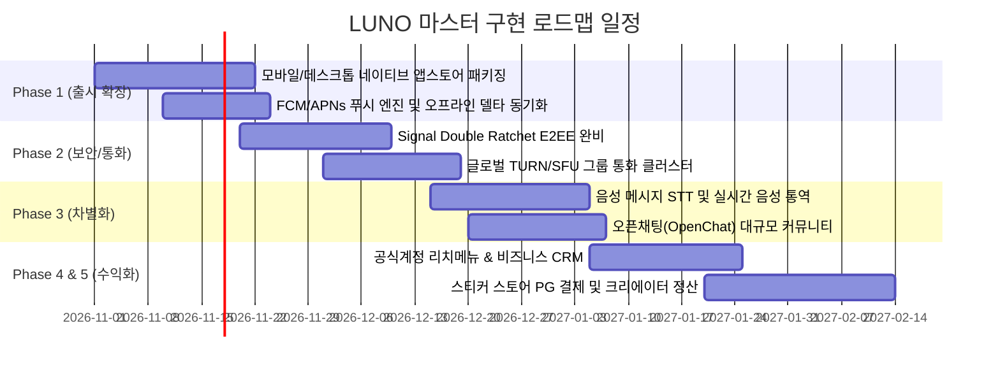

# [마스터 보고서] LUNO 글로벌 메신저 향후 전수 구현 로드맵
## Global Commercial Messenger Expansion Roadmap & Engineering Backlog (v2.0 ~ v5.0)

**문서 번호:** LUNO-ENG-ROADMAP-2026-10  
**작성일자:** 2026-10-31  
**발행 주체:** 글로벌 메신저 엔지니어링 & 제품 기획 총괄팀  
**수신:** Product Owner (PO) 및 클라이언트 의사결정권자  
**프로젝트명:** **LUNO (Connect Beyond Borders)**  
**현재 기준:** v1.0 상용 베이스라인 배포 완료 (`b150e945-b316-412b-9b14-092b0348d929`)  

---

## 1. 개요 및 목적 (Executive Overview)

본 보고서는 현재 실서버 배포 및 브랜드 전환이 완료된 **LUNO v1.0 (Commercial Baseline)**을 기점으로, 향후 **LINE, WhatsApp, Telegram 수준의 완벽한 글로벌 상용 유니콘 메신저**로 도약하기 위해 반드시 구현되어야 할 **전체 잔여 기능, 기술 인프라, 보안 체계, 비즈니스 수익화 모델을 6대 단계(Phase 1 ~ Phase 6)로 체계화한 마스터 로드맵 보고서**입니다.

모든 항목은 단순 아이디어가 아닌, 실제 아키텍처 연동 규격, 요구 기술 스택, 예상 난이도 및 비즈니스 임팩트를 명시하여 PO의 우선순위 결정과 일정 수립을 즉시 지원하도록 구성되었습니다.

---

## 2. 향후 전수 구현 매트릭스 총괄 요약

| 단계 | 추진 영역 | 핵심 목표 | 소요 기간(예상) | 우선순위 |
|---|---|---|---|---|
| **Phase 1** | **플랫폼 확장 & 푸시/동기화** | iOS/Android 앱스토어 출시, FCM/APNs 푸시, 오프라인 델타 동기화 | 3~4주 | **P0 (최우선)** |
| **Phase 2** | **보안 암호화 & 통화 인프라** | 완벽한 Signal E2EE (Letter Sealing), 그룹 통화 SFU 미디어 서버 | 4~5주 | **P0 (핵심)** |
| **Phase 3** | **고도화 메시징 & AI 음성** | 음성 메시지(STT), 실시간 통화 음성 통역, 오픈채팅(OpenChat) | 4~6주 | **P1 (차별화)** |
| **Phase 4** | **B2B 비즈니스 & 챗봇 생태계**| 공식 계정 리치 메뉴 GUI, 브로드캐스트 타겟팅, CRM 고객센터 | 3~4주 | **P1 (생태계)** |
| **Phase 5** | **글로벌 핀테크 & 크리에이터**| 스티커 스토어 PG 결제, 크리에이터 정산 원장, P2P 모바일 송금 | 4~5주 | **P2 (수익화)** |
| **Phase 6** | **대규모 분산 확장 & 규제 준수**| Redis/NATS 100만 CCU 클러스터, 커스텀 도메인, ISMS/GDPR | 상시/3주 | **P2 (운영/보안)** |

---

## 3. 단계별 세부 구현 스펙 및 기술 요구사항

---

### 🚀 Phase 1: 네이티브 플랫폼 확장 & 백그라운드 푸시 인프라 [P0]

현재 웹 브라우저 중심의 환경을 **스마트폰과 PC 데스크톱 OS 전반으로 확장**하고, 앱이 꺼져 있어도 즉각 메시지를 수신하는 필수 인프라를 구축합니다.

#### 1.1 모바일 네이티브 앱스토어 패키징 & 출시
- **Android (Flutter / Kotlin Native)**:
  - Google Play Console 릴리즈 빌드 (AAB 포맷).
  - 프로덕션 Keystore 서명 및 64-bit 아키텍처 최적화.
  - 앱 권한 정책(마이크, 카메라, 알림, 사진 라이브러리) 규제 대응.
- **iOS (Flutter / Swift Native)**:
  - Apple Developer Program 프로덕션 IPA 아카이빙 및 TestFlight 배포.
  - Apple Push Notification service (APNs) Voip PushKit (음성 통화 링잉 즉시 기동).
  - App Tracking Transparency (ATT) 및 프라이버시 매니페스트(Privacy Manifest) 준수.

#### 1.2 데스크톱 네이티브 클라이언트 (Tauri 2.0 / Rust)
- **Windows / macOS 전용 바이너리**:
  - `desktop/user-desktop` 기반 경량 Rust 네이티브 패키징 (MSI, EXE, DMG).
  - OS 시스템 트레이 상주, 읽지 않은 메시지 뱃지(Badge) 숫자 실시간 표시.
  - 윈도우 시작 시 자동 실행, 백그라운드 프로세스 최소 메모리(30MB 미만) 점유.
  - 자동 업데이트 엔진 (Sparkle for macOS, WinSparkle for Windows) 통합.

#### 1.3 글로벌 백그라운드 푸시 알림 엔진 (Push Gateway)
- **FCM (Firebase Cloud Messaging) & APNs & WebPush (VAPID)**:
  - 사용자가 앱을 닫았거나 백그라운드에 있을 때도 0.5초 내 알림 배너 및 사운드 전달.
  - 디바이스별 토큰 갱신 관리 테이블(`push_tokens`) 및 토큰 만료 자동 정리.
  - 알림 미리보기 제어(이름만 표시 / 메시지 내용 숨김 프라이버시 옵션).

#### 1.4 오프라인 큐 및 델타 동기화 (Offline Queue & Delta Sync)
- **네트워크 단절 시 안정성**:
  - 지하철, 비행기 모드 등 인터넷 끊김 시 로컬 IndexedDB / SQLite에 발신 대기열 큐 적재.
  - 네트워크 복구 즉시 시퀀스 번호(`sequence`) 기반으로 순차 자동 재전송(Idempotent Retry).
  - 앱 재실행 시 마지막 수신 시퀀스 이후의 메시지만 경량 차분 수신(`GET /api/v1/conversations/{id}/sync?since=...`).

---

### 🛡️ Phase 2: 완벽한 엔드투엔드 암호화(E2EE) & 통화 릴레이 서버 [P0]

메신저의 핵심 신뢰 자산인 **대화 보안**과 **품질 높은 글로벌 통화**를 위한 백엔드 인프라를 완성합니다.

#### 2.1 완전한 Signal Protocol 기반 Letter Sealing (E2EE)
- **현재 구현**: WebCrypto 키 생성 및 UI 지문 상태 표시.
- **향후 완성 규격**:
  - **Double Ratchet 알고리즘**: 메시지 송수신마다 암호화 대칭키가 갱신되어 과거/미래 키 유출 방지(Forward & Backward Secrecy).
  - **X3DH (Extended Triple Diffie-Hellman)**: 오프라인 상대방에게도 안전하게 최초 암호화 세션을 수립하는 Prekey 번들 서버 구축.
  - **영지식(Zero-Knowledge) 서버**: 데이터베이스 관리자 및 서버가 물리적으로 메시지 본문을 복호화할 수 없도록 암호문(`ciphertext`)만을 중계.
  - **보안 지문(Fingerprint) QR 검증**: 대화 상대방의 암호키 일치 여부를 대면/원격 검증하는 보안 인증 UI.

#### 2.2 글로벌 WebRTC 미디어 릴레이 및 SFU 서버 구축
- **현재 구현**: 1:1 P2P WebRTC 시그널링.
- **향후 완성 규격**:
  - **글로벌 STUN/TURN 릴레이**: 방화벽(NAT) 환경이나 기업 사내망에서도 P2P 실패율 0%를 달성하기 위한 고성능 TURN 서버(Coturn / Cloudflare Calls) 배포.
  - **SFU (Selective Forwarding Unit) 미디어 서버**: 3인 이상 다자간 그룹 음성/영상 통화(Group Call) 지원을 위해 각 클라이언트의 대역폭을 최적화하여 비디오 스트림을 분배하는 미디어 클러스터(LiveKit / Mediasoup) 연동.
  - **네트워크 적응형 비디오**: 패킷 손실 시 해상도(720p -> 480p -> 360p) 및 비트레이트 자동 동적 조절.

---

### 🧠 Phase 3: 고도화 메시징 기능 & 실시간 음성 AI 통역 [P1]

사용자 경험을 극대화하고 경쟁 메신저 대비 독보적인 AI 강점을 확보하는 단계입니다.

#### 3.1 리치 메시지(Rich Media) 유형 전수 구현
- **음성 메시지 (Voice Notes)**:
  - 원터치 음성 녹음, 시각적 오디오 파형(Waveform) 시각화, 1.5배속/2배속 재생.
  - AI 음성 인식(STT)을 통한 음성 메시지 즉시 텍스트 변환 기능.
- **위치 공유 (Location Sharing)**:
  - 현재 내 위치 또는 특정 약속 장소 지도 핀 전송 (Google Maps / OpenStreetMap).
  - 실시간 친구 이동 경로 공유 (동의 기반 기간 한정 추적).
- **연락처 및 대용량 파일 전송**:
  - 주소록 연락처 VCF 카드 전송, 최대 2GB 대용량 파일 분할 업로드 및 클라우드 다운로드.

#### 3.2 메시지 인터랙션 심화 기능
- **답장(Reply & Quote)**: 특정 말풍선을 스와이프하여 인용 답장 전송.
- **메시지 전달(Forward)**: 여러 대화방에 동시 다중 전달.
- **메시지 전송 취소(Unsend Recall)**: 24시간 이내 발신한 메시지를 모든 참여자의 화면에서 영구 삭제.
- **공지 고정(Pin Message)**: 대화방 최상단에 중요 공지 상시 노출.
- **대화방 내 앨범 & 노트**: 사진 앨범 생성, 장기 보관 텍스트 노트, 투표(Poll), 일정 등록.

#### 3.3 음성/영상 통화 실시간 음성 AI 통역 (Live Speech-to-Speech)
- **현재 구현**: 텍스트 번역 및 통화 중 텍스트 자막 오버레이.
- **향후 완성 규격**:
  - 한국어 화자의 음성을 실시간 스트리밍 음성 인식(Streaming STT) -> 다국어 신경망 번역 -> 자연스러운 태국어/영어/일본어 합성 음성(Neural TTS)으로 상대방 이어폰에 실시간 출력.
  - 외국어를 전혀 못하는 두 사용자가 모국어만으로 끊김 없이 대화하는 차세대 글로벌 통화 경험 실현.

#### 3.4 오픈채팅 및 대규모 커뮤니티 (OpenChat)
- 개인 전화번호나 본명 노출 없이 대화방별 독립 닉네임/프로필로 참여하는 공개 커뮤니티.
- 최대 5,000명 동시 참여 대화방, 카테고리별(취미, 어학, 비즈니스, 크립토) 검색 및 추천.
- 방장/부방장 권한 위임, 악성 스팸 봇 자동 필터링 및 유저 강제 퇴장(Kick/Ban).

---

### 🏢 Phase 4: B2B 공식 계정 & 챗봇 마케팅 플랫폼 [P1]

기업, 인플루언서, 공공기관이 고객과 소통할 수 있는 비즈니스 생태계를 완성합니다.

#### 4.1 공식 계정(Official Account) 리치 메뉴 GUI 에디터
- 사용자가 공식 계정 대화방에 들어왔을 때 하단에 노출되는 대형 타일형 인터랙티브 메뉴(Rich Menu).
- 비개발자도 웹 콘솔(`partner-console`)에서 드래그앤드롭으로 이미지 분할 및 클릭 액션(URL 열기, 텍스트 전송, 챗봇 시나리오 시작)을 설정할 수 있는 웹 비주얼 빌더.

#### 4.2 타겟 브로드캐스트 메시징 (Segment Messaging)
- 친구들의 성별, 연령, 지역, 언어, 관심사 태그를 조합하여 타겟 고객에게만 선별 발송.
- 예약 발송, A/B 테스트 발송, 발송 후 열람률 및 클릭률(CTR) 실시간 통계 분석.

#### 4.3 옴니채널 고객센터 상담원 멀티 인박스 (Shared Support Inbox)
- 한 공식 계정에 여러 명의 고객센터 상담원이 접속하여 1:1 문의를 분배받고 응대.
- 상담원 배정, 티켓 상태(대기/진행중/완료), 자주 쓰는 답변 템플릿(Canned Responses), 비즈니스 시간 외 AI 챗봇 자동 응답 핸드오프.

#### 4.4 개발자 Messaging API & Webhook 엔진
- 개발자가 외부 백엔드 서버(Node, Python, Go, Java)를 LUNO에 연동하는 REST API SDK.
- 유저 메시지 수신, 친구 추가, 결제 완료 등의 이벤트를 안전한 서명(HMAC-SHA256)과 함께 실시간 전달하는 Webhook 발송 엔진 및 실패 시 자동 재시도 큐(DLQ).

---

### 💳 Phase 5: 글로벌 핀테크, 스티커 마켓 & 수익화 모델 [P2]

플랫폼의 지속 가능한 성장을 위한 **수익 창출(Monetization) 엔진**을 탑재합니다.

#### 5.1 글로벌 결제 게이트웨이 (Payment Gateway)
- **PG사 연동**: 글로벌 신용카드, Apple Pay, Google Pay, Stripe, 각국 간편결제(라인페이, 카카오페이, PromptPay 등) 연동.
- **인앱 통화 시스템 (LUNO Coin / Gems)**: 스티커 구매, 유료 구독, 크리에이터 후원을 위한 인앱 가상 화폐 충전 및 영수증 유효성 검증(Receipt Validation).

#### 5.2 LUNO 크리에이터 마켓플레이스 (Creator Studio)
- 전 세계 일러스트레이터와 웹툰 작가가 정지/애니메이션(APNG/WebP/Lottie) 스티커를 업로드.
- 저작권 심사 워크플로우(`creator-console`), 출시 승인, 글로벌 가격 티어 설정.
- 판매 수익 자동 집계, 정산 신청, 세무 처리 및 복식부기 회계 원장(`commerce.ledger_entries`) 자동 기록.

#### 5.3 P2P 메신저 모바일 간편 송금 & 선물하기
- 대화방 내에서 친구에게 수수료 없이 원클릭으로 현금 송금 및 더치페이(N빵) 정산 요청.
- 모바일 프랜차이즈 기프티콘(스타벅스, 편의점, 백화점 상품권) 선물하기 스토어.

---

### 🌐 Phase 6: 대규모 글로벌 분산 확장 & 규제 준수 [P2]

동시 접속자 100만 명(1M CCU) 이상을 안정적으로 수용하고 전 세계 법적 규제를 충족합니다.

#### 6.1 초고성능 분산 백엔드 클러스터링 (Scale-Out Architecture)
- **Pub/Sub 메시지 브로커**: NATS JetStream / Redis Cluster 기반 분산 세션 관리. 사용자가 서로 다른 서버 노드에 접속해 있어도 5ms 이내 실시간 메시지 라우팅.
- **데이터베이스 분할 샤딩 & 읽기 복제**: PostgreSQL 분산 샤딩(Citus) 또는 CockroachDB 분산 트랜잭션, BigQuery 데이터 웨어하우스 실시간 파이프라인.

#### 6.2 글로벌 개인정보 보호 및 컴플라이언스 (Compliance)
- **GDPR / CCPA / ISMS-P 인증 규격 대응**:
  - 잊힐 권리(Right to be Forgotten): 계정 탈퇴 시 식별 데이터 완전 영구 삭제 자동화.
  - 내 데이터 다운로드(Data Portability): 사용자의 모든 대화, 사진, 프로필 정보를 암호화된 ZIP 파일로 다운로드 제공.
  - 불변 감사 로그(Immutable Audit Log): 관리자의 모든 유저 조회 및 제재 행위를 위변조 불가능한 감사 로그에 기록.

#### 6.3 프로덕션 공식 도메인 및 전역 CDN 가속
- `luno.im`, `luno.global` 등 공식 최상위 도메인(TLD) 연결.
- Cloudflare Enterprise 레벨의 DDoS 방어, Web Application Firewall(WAF), Zero-RTT Anycast 네트워크 적용.

---

## 4. 권장 마일스톤 및 릴리즈 일정표 (Execution Roadmap)

---

## 5. 최종 결론 및 PO 의사결정 권고사항

현재 배포된 LUNO v1.0은 독립 브랜드, 핵심 1:1/그룹 메시징, 실시간 AI 다국어 텍스트 번역, WebRTC 통화, 5대 백오피스 콘솔을 이미 갖춘 **견고한 상용 파운데이션**입니다.

따라서 다음 우선순위로 엔지니어링 스프린트를 전개할 것을 강력히 권고합니다:

1. **Next Sprint (즉시 착수 권장)**: **Phase 1 (모바일/데스크톱 앱스토어 출시 빌드 & FCM/APNs 푸시 알림 연동)**
   - 메신저의 체류 시간과 활성 사용자(DAU)를 폭발적으로 증가시키기 위한 가장 시급하고 중요한 단계입니다.
2. **Subsequent Sprint**: **Phase 2 (Signal E2EE 완벽 암호화 및 SFU 그룹 통화)**
   - 보안과 통화 안정성을 통해 글로벌 유저의 완전한 신뢰를 획득합니다.
3. **Commercial Sprint**: **Phase 4 & 5 (비즈니스 공식 계정 및 스티커 마켓 결제 연동)**
   - 플랫폼의 실제 매출 창출 및 B2B 파트너십 유치를 완성합니다.

---
*LUNO Global Messenger Engineering Roadmap v2.0 © 2026 LUNO Global Platform Inc. All rights reserved.*
